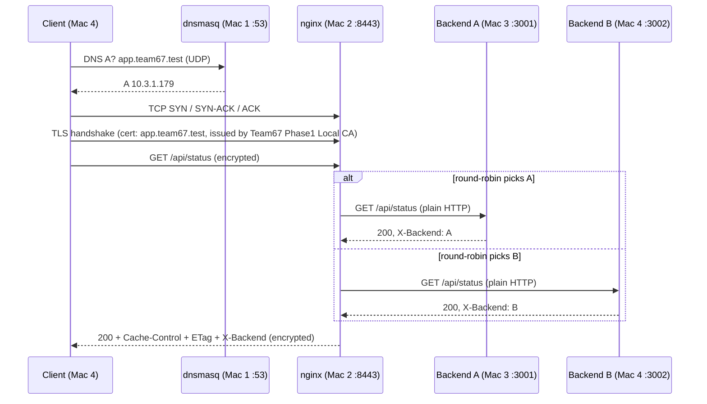

# Private Network Service Platform — Team 67

Computer Networks project, Phase 1: *Build and Observe*.

A client resolves `app.team67.test` through the team's own DNS server, connects to nginx over trusted HTTPS, and receives responses load-balanced across two HTTP backends. Every layer (DNS, TCP, TLS, HTTP, caching, load balancing) is backed by saved evidence.

## Team and machines

| Machine | Owner | Role | IP | Service port |
|---|---|---|---|---|
| Mac 1 | Nakul | Private DNS (dnsmasq) + client | `10.7.17.54` | UDP/TCP 53 |
| Mac 2 | Sudeshhna | Edge: nginx, TLS termination, load balancer | `10.3.1.179` | TCP 8443 |
| Mac 3 | Neelanshu | Backend A | `10.7.15.25` | TCP 3001 |
| Mac 4 | Puneet | Backend B + test client + packet capture | `10.7.21.130` | TCP 3002 |

Names: `app.team67.test` and `api.team67.test`, both resolving to the edge (`10.3.1.179`).

IP addresses are those in use during the evidence session on 5–6 October 2026 (IST). They are DHCP-assigned and must be re-checked at the start of every session.

## Request path



## Repository layout

```
dns/          dnsmasq configuration (Mac 1)
nginx/        nginx reverse proxy / TLS / load-balancer configuration (Mac 2)
backend-a/    Backend A source and launch instructions (Mac 3, port 3001)
backend-b/    Backend B source and launch instructions (Mac 4, port 3002)
tls/          CA and server certificate notes, SAN config, public certificates
wireshark/    Frame-by-frame annotation of the packet capture
docs/         Architecture, IP/service table, evidence checklist, failure demos
evidence/     Numbered evidence folder with INDEX.txt
```

## Quick start (bring-up order)

1. **Backends** — on Mac 3 and Mac 4:
   ```bash
   BACKEND_ID=A PORT=3001 python3 backend-a/app.py   # Mac 3
   BACKEND_ID=B PORT=3002 python3 backend-b/app.py   # Mac 4
   ```
2. **Edge** — on Mac 2: `nginx -t -c "$PWD/nginx/nginx.conf" && nginx -c "$PWD/nginx/nginx.conf"` (see [nginx/README.md](nginx/README.md)).
3. **DNS** — on Mac 1: start dnsmasq with [dns/dnsmasq.conf](dns/dnsmasq.conf) (see [dns/README.md](dns/README.md)).
4. **Client** — point Wi-Fi DNS at `10.7.17.54`, trust the team CA (see [tls/README.md](tls/README.md)), then:
   ```bash
   dig app.team67.test
   curl -v https://app.team67.test:8443/api/status
   ```
   `curl -k` is never used; the certificate must verify.

## Phase 1 status

| Requirement | Status | Where |
|---|---|---|
| Private DNS resolves both names to the edge | Done | [evidence/02_dns](evidence/02_dns) |
| Two backends reachable over the LAN | B done, A evidence pending | [evidence/03_backends](evidence/03_backends) |
| Trusted HTTPS through nginx (no `-k`) | Done | [evidence/04_nginx_tls](evidence/04_nginx_tls) |
| Round-robin load balancing | Done | [evidence/04_nginx_tls](evidence/04_nginx_tls) |
| Cache-Control + ETag + 304 | Done | [evidence/05_cache](evidence/05_cache) |
| DNS / TCP / TLS packet capture, annotated | Done | [wireshark/README.md](wireshark/README.md) |
| Five failure demonstrations | 1 of 5 saved | [docs/failure-demos.md](docs/failure-demos.md) |
| LAN inventory and reachability | Pending | [evidence/01_lan](evidence/01_lan) |

Full requirement-to-file mapping: [evidence/INDEX.txt](evidence/INDEX.txt) and [docs/demo-evidence.md](docs/demo-evidence.md).

## Security notes

- Private keys (`*.key`), CSRs and the CA serial file are excluded by `.gitignore` and are never committed. Only public certificates are tracked.
- The packet capture in this repository is filtered to project traffic only.
- The CA in `tls/certs/` is a throwaway lab CA for the `.test` namespace. Remove it from your keychain when the project ends.
