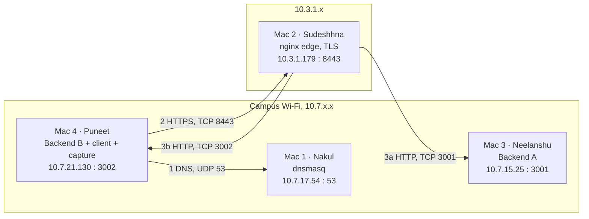

# Architecture

## 1. Overview

Four laptops form a private service platform:

- **Private DNS** (dnsmasq) for the `team67.test` zone
- **Edge** (nginx) doing TLS termination, reverse proxying and round-robin load balancing
- **Two HTTP backends** (Python standard library) that identify themselves and emit caching headers
- **Client / capture host** used for validation and packet evidence

Nothing depends on public DNS or a public CA. Names live in the reserved `.test` namespace.

## 2. Topology

**Addressing note.** During the evidence session the edge had an address in `10.3.1.x` while the other three machines were in `10.7.x.x`. Pings from Mac 4 to the edge return with `ttl=63` (one below the macOS default of 64), which indicates one routed hop between them. All addresses are private (RFC 1918) and traffic stays inside the campus network, but the four machines were not in a single broadcast domain. Subnet masks and gateway are recorded with the LAN inventory in `evidence/01_lan/`.

## 3. Machines and services

See [ip-service-table.md](ip-service-table.md).

## 4. Request flow by protocol layer

| # | Step | Application | Transport | Network (src → dst) | Evidence |
|---|---|---|---|---|---|
| 1 | Client asks for `app.team67.test` | DNS A query | UDP, ephemeral → 53 | `10.7.21.130` → `10.7.17.54` | capture frames 1, 3 |
| 2 | DNS answers `10.3.1.179` | DNS response | UDP, 53 → ephemeral | `10.7.17.54` → `10.7.21.130` | frames 2, 4; `dig` output |
| 3 | Client opens a connection to the edge | — | TCP SYN / SYN-ACK / ACK, ephemeral → 8443 | `10.7.21.130` → `10.3.1.179` | frames 5–7 |
| 4 | TLS handshake | TLS ClientHello (SNI) … Finished | TCP 8443 | same | frames 8–16; `curl -v` |
| 5 | HTTP request inside TLS | `GET /api/status` (encrypted) | TCP 8443 | same | frame 18 |
| 6 | nginx selects a backend and forwards | `GET /api/status` (plain HTTP/1.1) | new TCP connection, ephemeral → 3001 or 3002 | `10.3.1.179` → `10.7.15.25` or `10.7.21.130` | frames 20–23 |
| 7 | Backend responds | `200 OK` + `X-Backend`, `Cache-Control`, `ETag` | TCP | backend → `10.3.1.179` | frames 25–26 |
| 8 | nginx returns the response | HTTP 200 (encrypted) | TCP 8443 | `10.3.1.179` → `10.7.21.130` | frame 29; `curl -v` |

Frame numbers refer to the annotated capture in [`wireshark/README.md`](../wireshark/README.md).

## 5. Design decisions

| Decision | Reason |
|---|---|
| `.test` suffix, not `.local` | `.test` is reserved for testing; `.local` collides with macOS multicast DNS |
| HTTPS on 8443, not 443 | nginx does not need root; explicitly permitted by the brief |
| Local CA + SAN certificate | Lets clients verify the edge properly; `curl -k` is never needed |
| TLS terminated at nginx | One certificate to manage; backends stay simple; nginx can read HTTP to route it |
| One backend source, identity from env vars | A and B behave identically, so `X-Backend` is the only difference and load balancing is easy to prove |
| `max_fails=1 fail_timeout=5s` + `proxy_next_upstream` | A dead backend is skipped and the request retried on the other, so a single failure is invisible to clients |
| Per-backend ETag (`phase1-A-v1` / `phase1-B-v1`) | Keeps identity visible, at the cost described below |

## 6. Caching behaviour

Backends send `Cache-Control: public, max-age=60` and an `ETag`.

- `max-age=60`: a cache may reuse the stored response for 60 seconds without contacting the server.
- `ETag` + `If-None-Match`: after that (or on demand) the client revalidates; if the validator matches, the server replies `304 Not Modified` with no body.

Because each backend has its own ETag, a conditional request carrying B's ETag gets `304` only when round-robin routes it to B; if it lands on A, A returns a full `200`. The saved evidence shows a 304 both directly from B and through the edge. A production design would derive the ETag from content so both backends agree.

## 7. Failure boundaries

| Fault | DNS | TCP | TLS | HTTP |
|---|---|---|---|---|
| Wrong DNS server on client | fails | — | — | — |
| DNS record points to wrong IP | succeeds (wrong answer) | fails or reaches wrong host | — | — |
| One backend stopped | ok | ok | ok | 200, only the survivor answers |
| Both backends stopped | ok | ok | ok | 502 Bad Gateway |
| Wrong destination port | ok | refused (RST) | — | — |

Diagnose in the order DNS → TCP → TLS → HTTP. Details and saved transcripts: [failure-demos.md](failure-demos.md).
