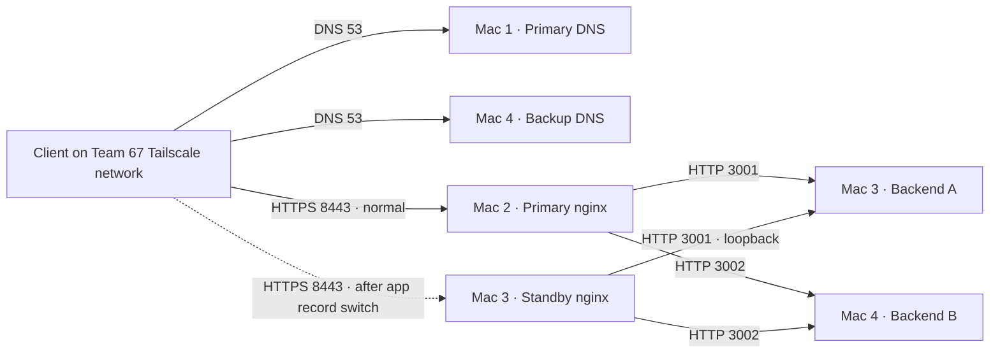

# Team 67 · Phase 2 report

**Private Network Service Platform** · Test session 25 November 2026 (IST)

Nakul Jaglan · Sudeshhna Behera · Neelanshu Karn · Puneet Kathuria

## What changed from Phase 1

Phase 1 used campus network addresses for private DNS, one nginx edge, and two HTTP backends. For Phase 2, our Macs were on different Wi-Fi networks, so we joined one private Tailscale network. Tailscale gave each Mac a reachable VPN address. We kept the project DNS, nginx, TLS certificates and backends on our Macs. We added a second DNS server and a standby nginx, and set the DNS TTL to 30 seconds. The original [Phase 1 architecture](architecture.md) and [packet capture](../wireshark/README.md) use the campus addresses.

| Mac | Owner | Tailscale IP | Services |
|---|---|---|---|
| 1 | Nakul | `100.96.176.78` | Primary dnsmasq, UDP/TCP `53` |
| 2 | Sudeshhna | `100.98.167.117` | Primary nginx, HTTPS TCP `8443` |
| 3 | Neelanshu | `100.91.79.59` | Backend A, HTTP TCP `3001`; standby nginx, HTTPS TCP `8443` |
| 4 | Puneet | `100.97.35.89` | Backend B, HTTP TCP `3002`; backup dnsmasq, UDP/TCP `53` |

Both resolvers normally point `app.team67.test` and `api.team67.test` to Mac 2. Tailscale forwards lookups for `team67.test` to the project resolvers. The client opens TCP 8443, verifies the hostname against the edge certificate and the team CA, then sends the HTTPS request. nginx terminates TLS and proxies plain HTTP to a backend. `X-Edge` identifies the edge and `X-Backend` identifies the backend. The [Mac 1 ping capture](../evidence/phase2/vpn-mac1-ping.txt) shows 4/4 replies from each peer. A complete pairwise matrix is pending.

## Phase 2 extensions

### A. Backup DNS resolver

We stopped only the primary dnsmasq service while Mac 1 stayed reachable. Mac 3’s direct query to Mac 1 timed out, while its normal lookup still returned Mac 2 and HTTPS returned a verified HTTP 200. A separate run with Mac 1 offline matched Mac 3’s normal lookup to query lines in Mac 4’s dnsmasq log. The primary answered again after restart. This showed that we could lose a resolver and still reach the application when the backup resolver and the edge were available. [Failover and recovery evidence](../evidence/phase2/A-dns-failover-vpn.txt)

### B. DNS TTL and controlled record change

In an isolated Mac 1 rehearsal, a test cache retained `192.0.2.10` with 29 seconds remaining even after the source changed to `192.0.2.20`. The cache picked up the new value after expiry. In a separate step, manually clearing the test cache made it pick up the restored record immediately. A DNS record change can therefore reach clients at different times, depending on what each client has cached. [TTL expiry and cache clear evidence](../evidence/phase2/nakul-local-dns.txt)

### C. Backend service isolation

Mac 1’s baseline showed HTTP 200 from both backend ports and through the primary edge. Mac 4 reported a validated PF setup. Mac 3 prepared a rule and rollback, but the project anchor was unconfirmed on that Mac. The firewall-on and rollback tests are pending. The acceptance check is direct HTTP 200 from Mac 2 to both backend ports, both direct connections blocked from Mac 1, working HTTPS through the primary edge, and restored direct access from Mac 1 after rollback. The test must check traffic from an actual client because a rule entered in an unattached anchor has no effect. [Baseline and test status](../evidence/phase2/C-backend-isolation-vpn.txt)

### D. Backend failover and recovery

The primary initially returned `A B A B A B` over six requests. With A stopped, all six Mac 1 HTTPS requests returned HTTP 200 from B. The primary nginx log recorded a refused connection to A, a retry to B, and a 200 to the client on the same request. Both backend IDs returned after A restarted, without an nginx reload. In the separate both-down test, DNS and certificate verification still worked, but nginx returned `502 Bad Gateway`. Both edges recovered after the backends restarted. Mac 2’s normal ingress role remains a single point of failure until traffic is directed to the standby. Automatic edge recovery would require a health-checked ingress or a coordinated automatic DNS failover mechanism. [A-down and recovery](../evidence/phase2/D-backend-failover-vpn.txt) · [Both-down and recovery](../evidence/phase2/phase1-both-backends-down-vpn.txt)

### E. DNS-based migration to the standby edge

We moved only `app.team67.test` to Mac 3, keeping `api.team67.test` on Mac 2. Mac 3 observed its first verified standby HTTP 200 at 13:05:41, 13 seconds after the primary resolver reload. The second resolver reloaded at 13:07:08, so both answers appeared during the roughly 100-second gap. Mac 3 reported 110 successful requests in the monitored cutover window. An independent Mac 1 request reached the standby by hostname using normal DNS. Both records were restored to Mac 2 and verified. The transition showed why both edges should stay available while caches expire and both resolvers converge. [Cutover and rollback timeline](../evidence/phase2/B-E-dns-cutover-vpn.txt) · [Independent standby HTTPS](../evidence/phase2/E-mac1-standby-by-name.txt)

### F. Faculty-injected troubleshooting

This challenge is performed during evaluation. We start with the DNS answer, test TCP 8443, check the TLS handshake and certificate, and then inspect HTTP status and upstream logs. In our own tests, we saw a correct DNS answer with a TCP timeout while the edge Mac was offline, and verified TLS with a 502 when both backends were down. These observations let us narrow the investigation to the failing hop. [Live demo commands](phase2-demo.md)

## Evidence and configuration bundle

- [Phase 2 DNS configs and runbook](../phase2/dns/README.md) · [Phase 2 nginx config templates](../phase2/nginx/README.md) · [CA and TLS setup](../tls/README.md)
- [Backend A](../backend-a/) · [Backend B](../backend-b/) · [Phase 1 evidence index](../evidence/INDEX.txt)
- [Phase 1 packet analysis](../wireshark/README.md) · [HTTP caching and 304](../evidence/05_cache/cache-control-and-304.txt) · [Wrong-port fault](../evidence/07_failures/05-wrong-port-before-after.txt)

The remaining Phase 1 fault captures are the wrong client DNS server and the incorrect DNS record. The one-backend-down and both-backends-down faults have VPN evidence linked above.
